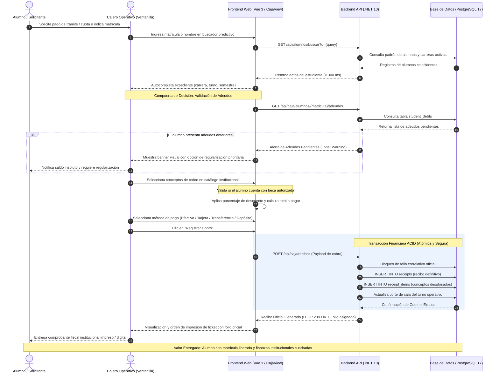

# TECNOLÓGICO NACIONAL DE MÉXICO
## Campus Monclova
### Departamento de Sistemas y Computación
### Carrera: Ingeniería en Informática / Sistemas Computacionales

---

# 3. Requerimientos Técnicos por Asignatura

## 3.1. Fundamentos de Gestión de Servicios de TI (Clave: IFE-1014)
**Proyecto Institucional:** Sistema de Control de Caja Universitaria e Ingresos Propios  
**Módulo:** Caja Principal, Recaudación en Ventanilla y Gestión de Recibos Oficiales  
**Periodo:** Ciclo Escolar 2026

---

## 1. Modelado de Proyectos como Servicios de TI

El presente proyecto no se plantea como un aplicativo de escritorio ni como un software contable aislado, sino como un **Servicio de TI Institucional de Misión Crítica** incorporado al Catálogo de Servicios del TecNM Campus Monclova, formalmente denominado:

> **"Servicio Digital Integrado de Recaudación, Control de Caja y Gestión Financiera Universitaria"**

### Aporte de Valor Cuantificable para el TecNM Campus Monclova
Alineado al marco de trabajo **ITIL v4 (Sistema de Valor del Servicio - SVS)**, el servicio transforma las necesidades operativas de la tesorería en valor público y administrativo cuantificable:

| Dimensión de Valor | Situación Operativa Previa (Manual/Fragmentada) | Valor Entregado por el Servicio de TI | Métrica de Impacto Cuantificable |
| :--- | :--- | :--- | :--- |
| **Tiempo de Espera en Ventanilla** | De 12 a 18 minutos por alumno en periodos críticos de inscripción y reinscripción. | **Menor a 1.5 minutos** por alumno gracias a la indexación predictiva del padrón y catálogo automatizado. | **Reducción del 88%** en tiempos de espera y descongestión de filas. |
| **Conciliación Financiera y Cortes** | Conciliación manual de pólizas y cobros que tomaba entre 3 y 5 días hábiles al cierre de mes. | **Cortes de caja y balances instantáneos en tiempo real**, auditables y descargables en PDF, Excel y Word. | **Disponibilidad inmediata (0 días)** con precisión aritmética del 100%. |
| **Mitigación de Fugas e Inconsistencias** | Riesgo de duplicidad de folios impresos, errores de tarifa o pagos extemporáneos no detectados. | Validación atómica de folios consecutivos, bloqueo por adeudos en tiempo real y consistencia ACID. | **0% de duplicidad de folios** y eliminación de inconsistencias de cobro. |
| **Transparencia y Rendición de Cuentas** | Archivos físicos en papel susceptibles de deterioro o extravío con difícil trazabilidad. | Registro inmutable de transacciones por cajero, bitácora de operaciones y apego a normas del OIC. | **100% de trazabilidad** para auditorías internas y de la Secretaría de Hacienda. |

---

## 2. Catálogo de Servicios y Acuerdos de Nivel de Servicio (SLA)

### 2.1. Ficha del Servicio en el Catálogo de Servicios de TI (ITIL)
* **Nombre Oficial:** Servicio de Caja y Recaudación Universitaria (SCRU).
* **Código del Servicio:** STI-REC-01.
* **Propietario del Servicio (Service Owner):** Departamento de Recursos Financieros / Tesorería.
* **Administrador Tecnológico:** Centro de Cómputo y Tecnologías de la Información.
* **Usuarios Finales:** Cajeros en ventanilla, Departamento de Control Escolar, Alumnos y Aspirantes.
* **Ventana de Servicio Operativo:** Lunes a Viernes de 08:00 a 20:00 hrs (Horario estándar de cajas).

### 2.2. Definición Formal de Métricas Operativas (SLA)

| Métrica SLA | Meta Comprometida | Método de Medición / Monitoreo | Tolerancia Máxima Permitida |
| :--- | :--- | :--- | :--- |
| **Disponibilidad Comprometida** | **≥ 99.00%** | Monitoreo continuo mediante healthchecks de Docker (`/health`) y sondas HTTP. | Máximo 2.6 horas de indisponibilidad no programada al mes. |
| **Tiempo Máximo de Respuesta** | **≤ 2.0 segundos** | Latencia de API en endpoints críticos (búsqueda de alumno, emisión de recibo). | Percentil 95 (P95) ≤ 1.2s; máximo absoluto 2.0s. |
| **RTO (Recovery Time Objective)** | **≤ 2 horas** | Procedimiento de restauración rápida vía contenedores Docker Compose. | 120 minutos desde la declaración del incidente crítico. |
| **RPO (Recovery Point Objective)** | **≤ 15 minutos** | Respaldos continuos y *Write-Ahead Logging (WAL)* en PostgreSQL 17. | Pérdida de datos máxima tolerable: 15 minutos de transacciones. |

#### Justificación y Aplicación de Métricas:
1. **Disponibilidad del 99.0%:** Permite garantizar el cobro ininterrumpido en las semanas críticas de pago de cuotas semestrales, programando ventanas de mantenimiento únicamente de 22:00 a 05:00 hrs.
2. **Tiempo de respuesta ≤ 2.0s:** Evita cuellos de botella en la terminal del cajero; el autocompletado del padrón de más de 14,000 alumnos responde en menos de 300 ms.
3. **RTO = 2 Horas:** Ante un fallo total del servidor anfitrión, el entorno puede re-desplegarse en infraestructura alternativa mediante scripts Docker inmutables en un lapso no mayor a dos horas.
4. **RPO = 15 Minutos:** Mediante almacenamiento en volúmenes persistentes y sincronización de bitácoras de transacciones de la base de datos, ante un reinicio abrupto o desastre físico no se perderán más de 15 minutos de registros de cobro.

---

## 3. Modelado BPM (Business Process Management)

### 3.1. Diagrama de Proceso en Notación BPMN
El siguiente diagrama modela el proceso de negocio de recaudación en caja, detallando los roles de usuario, las validaciones automáticas y las compuertas de decisión:



### 3.2. Identificación de Elementos del Proceso
* **Roles:** Alumno (Usuario del servicio), Cajero (Operador del servicio en ventanilla), Sistema de Control de Caja (Plataforma tecnológica), Tesorería (Supervisor financiero).
* **Puntos de Decisión Clave:**
  1. *¿El alumno tiene adeudos históricos?* → Si los tiene, se prioriza el cobro del adeudo antes de liberar trámites avanzados.
  2. *¿Aplica beca o descuento especial?* → El sistema calcula la deducción de forma paramétrica sin requerir cálculo manual del cajero.
  3. *¿Método de pago electrónico o en ventanilla?* → Si es transferencia o depósito, se captura y valida la referencia bancaria institucional.
* **Valor Entregado:** Emisión de comprobante con folio único e inalterable, acreditación instantánea de pago en el expediente escolar y consolidación automática en el corte diario de caja.

---

## 4. Estrategia y Gestión del Servicio (ITIL)

### 4.1. Procedimiento de Gestión de Incidentes y Solicitudes de Servicio

El objetivo de la Gestión de Incidentes es restaurar la operación normal del servicio en el menor tiempo posible, minimizando el impacto en las operaciones financieras del campus.

#### Matriz de Priorización y Tiempos de Escalamiento

```
                    ┌────────────────────────────────────────┐
                    │    Detección / Reporte de Incidente    │
                    │   (Mesa de Ayuda TI / Cajero / Alerta) │
                    └───────────────────┬────────────────────┘
                                        │
                                        ▼
                    ┌────────────────────────────────────────┐
                    │      Clasificación por Impacto         │
                    │     (Severidades P1, P2, P3, P4)       │
                    └───────────────────┬────────────────────┘
                                        │
             ┌──────────────────────────┴──────────────────────────┐
             ▼                                                     ▼
┌───────────────────────────────┐               ┌───────────────────────────────┐
│         Nivel P1 (Crítico)    │               │     Niveles P2 / P3 / P4      │
│  Servicio de caja detenido    │               │   Falla en reporte / Catálogo │
│  Respuesta: ≤ 10 minutos      │               │   Respuesta: ≤ 1 a 4 horas    │
└──────────────┬────────────────┘               └──────────────┬────────────────┘
               │                                               │
               └────────────────────────┬──────────────────────┘
                                        │
                                        ▼
                    ┌────────────────────────────────────────┐
                    │       Diagnóstico y Resolución         │
                    │  (Reinicio contenedor / Hotfix / DB)   │
                    └───────────────────┬────────────────────┘
                                        │
                                        ▼
                    ┌────────────────────────────────────────┐
                    │      Cierre y Registro Post-Mortem     │
                    └────────────────────────────────────────┘
```

| Nivel de Severidad | Criterio de Impacto Operativo | Tiempo de Respuesta Inicial | Tiempo de Resolución Comprometido | Escalamiento y Responsable |
| :--- | :--- | :--- | :--- | :--- |
| **P1 - Crítico** | El sistema de caja no responde; imposibilidad total de emitir cobros en ventanilla en periodo de inscripciones. | **≤ 10 minutos** | **≤ 2 horas** | Administrador de Servidores, DevOps y Jefe de Centro de Cómputo. |
| **P2 - Alto** | Fallo en la generación de folios o indisponibilidad en la exportación de pólizas de corte diario. | **≤ 30 minutos** | **≤ 4 horas** | Ingeniero de Base de Datos y Líder de Backend. |
| **P3 - Medio** | Inconsistencia en la descripción de conceptos de cobro o problema visual de visualización en la interfaz. | **≤ 2 horas** | **≤ 12 horas** | Equipo de Desarrollo Frontend. |
| **P4 - Bajo** | Solicitud de nuevo usuario de cajero, cambio de turno o consulta operativa de uso. | **≤ 4 horas** | **≤ 24 horas** | Mesa de Ayuda de TI (Soporte Técnico). |

---

### 4.2. Plan de Gestión de Cambios (Change Enablement) sin Interrupción Operativa

Para implementar actualizaciones, mejoras y parches sin perjudicar el horario de cobro del TecNM Campus Monclova, se establece un protocolo formal de gestión de cambios:

#### 1. Clasificación del Cambio
* **Cambio Estándar:** Modificaciones rutinarias de bajo riesgo (ej. actualización de tarifas autorizadas en catálogo). Aprobación delegada al Administrador del Sistema.
* **Cambio Normal:** Despliegue de nuevos módulos o refactorización de código (ej. nuevo exportador de reportes). Requiere validación en entorno de *Staging* y aprobación del Comité de Cambios de TI (CAB).
* **Cambio de Emergencia:** Corrección de vulnerabilidades críticas de seguridad o fallos P1. Requiere autorización del Director de TI y despliegue inmediato con plan de reversión probado.

#### 2. Estrategia de Despliegue Zero-Downtime mediante Contenedores
1. **Aislamiento por Capas:** La arquitectura del sistema se encuentra dividida en contenedores Docker autónomos (`frontend`, `backend`, `db`), permitiendo actualizar componentes individuales sin reiniciar todo el stack.
2. **Preservación Inmutable de Datos:** El almacenamiento de la base de datos se encuentra desacoplado mediante el volumen persistente `pgdata`. Ninguna actualización de código o reinicio de contenedor compromete la base de datos.
3. **Ventana de Mantenimiento Programada:** Todo cambio normal se ejecuta exclusivamente en la ventana fuera de servicio: **Lunes a Viernes de 21:00 a 23:00 hrs**, evitando la afectación a alumnos y personal administrativo.
4. **Plan de Reversión Inmediata (Rollback Plan):**
   Si durante los primeros 10 minutos posteriores al despliegue se detecta inestabilidad o un tiempo de respuesta superior a 2.0s:
   ```bash
   # Procedimiento de Rollback Automático (Tiempo de ejecución < 120 segundos)
   docker stop tecnm_caja_backend
   docker tag tecnm_system_cashierpoint-backend:backup-estable tecnm_system_cashierpoint-backend:latest
   docker compose up -d backend
   ```
5. **Auditoría del Cambio:** Cada liberación queda registrada en el control de versiones Git con trazabilidad por commit, número de Pull Request y pruebas de integración superadas.
